<p align="center"></p>

# The kidney cancer lipidome: a lipidomics analysis in the LSMA Analysis Lab

**Clear cell kidney cancer is full of fat. How does the tumour change the kinds of lipids it holds?**

This repository is a worked example from the **LSMA Analysis Lab**, the analysis platform of the [London School of Multiomics & AI](https://lsma.co.uk). The full analysis was run in the lab, without writing code: upload of a lipid table, quality control, normalisation, exploration, lipid classes, chain length and saturation, differential abundance and a multivariate model. The report, figures and tables it produced are here, with a validation in an independent cohort and against the enzymes measured in the companion analyses.

| | |
|---|---|
| **Data** | The lipids measured in the metabolic atlas of clear cell kidney cancer (Hakimi et al., *Cancer Cell* 2016, Memorial Sloan Kettering), from the open [Zenodo archive](https://doi.org/10.5281/zenodo.7348648) of Benedetti et al. (CC BY 4.0) |
| **Samples** | 280: tumour and normal kidney from the same 140 patients |
| **Lipids** | 107 lipids written in standard lipid shorthand (fatty acids, acylcarnitines, lysophospholipids, monoacylglycerols, sphingolipids, cholesterol); 104 kept after quality control |
| **Comparison** | tumour vs adjacent normal kidney, paired by patient |
| **Lab module** | Lipidomics (workflow version 1.0.0) |
| **Lab run time** | **55 s** for the whole analysis (the table uploads in a few seconds) |
| **Validation** | An independent MSKCC cohort (18 other patients) run through the same lab workflow (30 s), a robustness re-run (40 s), and the enzymes from the [proteomics](https://github.com/MultiOmics-Intelligence/lsma-lab-proteomics-kidney-cancer-cptac) and [bulk RNA-seq](https://github.com/MultiOmics-Intelligence/lsma-lab-bulk-rnaseq-kidney-cancer-tcga-kirc) analyses |
| **Result** | **Replicated**: all 28 strong changes go the same way in the independent cohort (ρ = 0.86), and the loss of polyunsaturated lipids and lysophospholipids is seen in both cohorts |

---

## Biological question and aim

**Question.** Clear cell kidney cancer takes its name from its lipid-filled cells. The [metabolomics analysis](https://github.com/MultiOmics-Intelligence/lsma-lab-metabolomics-kidney-cancer) looked at all small molecules one by one. Here the question is about lipids as a whole: which classes of lipid does the tumour gain or lose, and are its fatty acids longer or shorter, more or less saturated?

**Hypothesis.**
- If the tumour turns down fatty acid burning in its mitochondria, the fatty acids waiting to be burned (acylcarnitines) should build up.
- If the tumour makes more of its own mono-unsaturated fatty acids, its lipids should shift away from polyunsaturated chains.
- These shifts should follow the enzymes that make or use the lipids, measured in other patients.

**Aims**
1. Write the lipids of a public tissue cohort in standard lipid shorthand, so the lab can read their structure.
2. Check the quality of 280 tissue lipid profiles.
3. Compare the lipid classes, chain lengths and saturation of tumour and normal kidney within each patient.
4. Find the single lipids that change, and test whether all lipids together tell tumour from normal.
5. Repeat the analysis in an independent cohort and without the samples flagged by quality control.
6. Check the main shifts against the enzymes at protein and RNA level.
7. Show each step as it is run in the LSMA Analysis Lab, so a student can repeat it.

---

## Background: lipids in clear cell kidney cancer

**Lipids** are fats and fat-like molecules. They build cell membranes, store energy and send signals. Lipidomics measures many of them at once, and each lipid's name carries its structure:
- `FA 18:1` is a fatty acid with 18 carbons and one double bond.
- `LPE 16:0/0:0` is a lysophosphatidylethanolamine, a membrane lipid that has lost one of its two fatty acid chains.
- `CAR 16:0` is palmitoylcarnitine, a fatty acid on its way into the mitochondria to be burned.

**Saturation** describes the double bonds in a lipid's chains:
- *saturated* lipids have none;
- *mono- or di-unsaturated* lipids have one or two;
- *polyunsaturated* lipids have three or more. They make membranes fluid, but they are also easily damaged by oxidation.

**Clear cell renal cell carcinoma (ccRCC)** stores large amounts of fat in lipid droplets. Loss of *VHL* and the hypoxia programme it unleashes (see the [bulk](https://github.com/MultiOmics-Intelligence/lsma-lab-bulk-rnaseq-kidney-cancer-tcga-kirc) and [proteomics](https://github.com/MultiOmics-Intelligence/lsma-lab-proteomics-kidney-cancer-cptac) analyses) rewires lipid handling:
- **Less fat is burned.** Du et al. (*Nature Communications* 2017) showed that HIF represses CPT1A, the gate into the mitochondria, and that this drives lipid storage.
- **More fat is desaturated.** Von Roemeling et al. (*Clinical Cancer Research* 2013) found the desaturase **SCD1** strongly increased in ccRCC, and needed by the tumour cells.

---

## Key findings

1. **The tumour lipidome is very different from normal kidney.**
   - **82 of 104 lipids change** (adjusted p < 0.05): 45 higher and 37 lower in the tumour (Figure 6).
   - **A model built on all lipids tells tumour from normal**, also for samples it was not trained on (OPLS-DA: Q2 = 0.84, permutation p = 0.005; Figures 8–9).
2. **Lysophospholipids collapse** (Figures 1–2).
   - **Lysophosphatidylethanolamines (LPE)** fall from **5.9% to 0.6%** of the lipid signal: the strongest change of any class (adjusted p ≈ 10⁻²³).
   - The single most changed lipids are all LPE, such as **LPE 16:0/0:0**, which is 28-fold lower (log2 fold change −4.84).
   - The ether lipid LPE P-16:0, lysophosphatidylinositols (LPI), lysophosphatidylserines (LPS) and lysophosphatidylcholines (LPC) fall as well.
3. **Acylcarnitines build up.** Their share of the lipid signal doubles, from **7.0% to 14.3%**. Examples: palmitoylcarnitine (CAR 16:0, +1.51), oleoylcarnitine (CAR 18:1, +2.22) and acetylcarnitine (CAR 2:0, +1.67). This is the sign of fatty acids waiting at the mitochondria and not being burned.
4. **Fewer polyunsaturated chains** (Figures 3–5).
   - **Polyunsaturated lipids fall** from **31% to 17%** of the signal.
   - **Mono- or di-unsaturated lipids rise** from 32% to 42%, and saturated lipids from 37% to 40%.
   - **The average lipid loses 0.44 double bonds** (1.71 to 1.27; adjusted p ≈ 10⁻²¹) and is shorter (18.1 to 16.8 carbons).
   - Among the free fatty acids, arachidonic acid (FA 20:4, −1.40) and DHA (FA 22:6, −1.12) fall, while oleic acid (FA 18:1, +0.68) and the very long mono-unsaturated FA 22:1 and FA 24:1 rise (+2.73 and +2.44).
5. **More sphingoid bases.** Sphingosine and sphinganine are about 3-fold higher. Sphingomyelin and the monoacylglycerols do not change.

Evidence labels from the lab: the differential abundance, class and chain comparisons and the OPLS-DA model are *statistically supported*; the pathway readings are *biological interpretation*.

---

## Quality control and PCA

| Check | Result |
|---|---|
| Lipids | 107 lipids uploaded, written in standard shorthand ([`data-preparation/`](data-preparation)); 106 have a readable chain, while cholesterol has none and counts only in the class composition |
| Filtering | **104 kept**; 3 removed because they were measured in fewer than half of the samples of both groups (Figure QC2) |
| Missing values | 12% of the uploaded values; after filtering, 11% were filled in with half of the lowest measured value |
| Normalisation | probabilistic quotient normalisation (PQN), then log2 (Figure QC3) |
| Flagged samples | none in this lipid subset. The three low-signal tumours from the metabolomics run were still removed in a robustness re-run (see Validation) |
| Pooled QC samples | none in the public data, so lipid reproducibility over the run couldn't be checked |

**PCA (Figure QC4).**
- **PC1 (33% of all variation) separates tumour from normal**, with a few samples of each group in between.
- PC2 (19%) spreads the samples within each group.
- Figure QC5 shows which sample details explain each component.

| | |
|---|---|
| 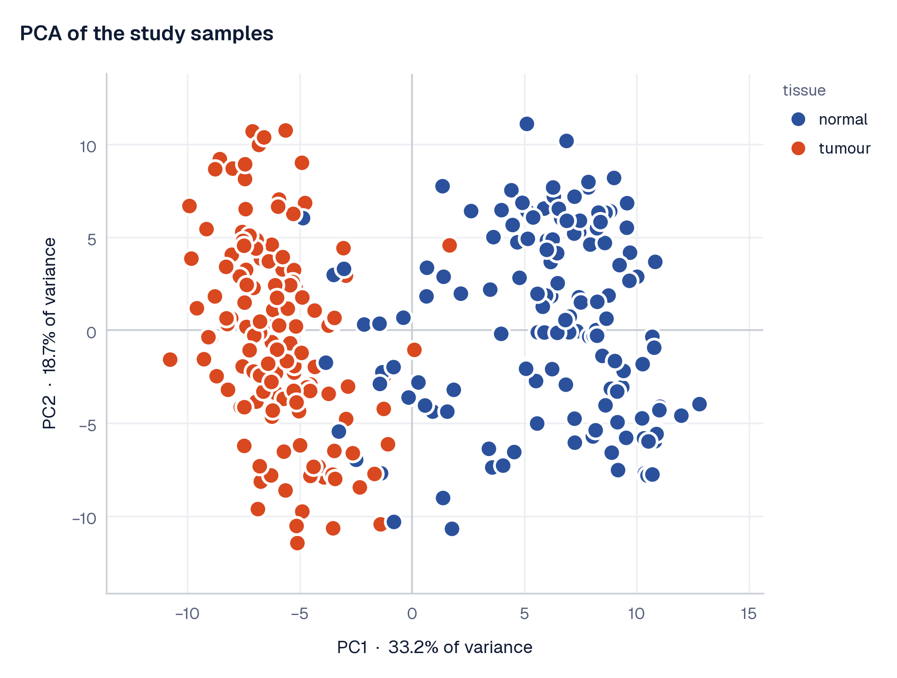 **QC4.** PCA: tumour and normal separate on PC1. | 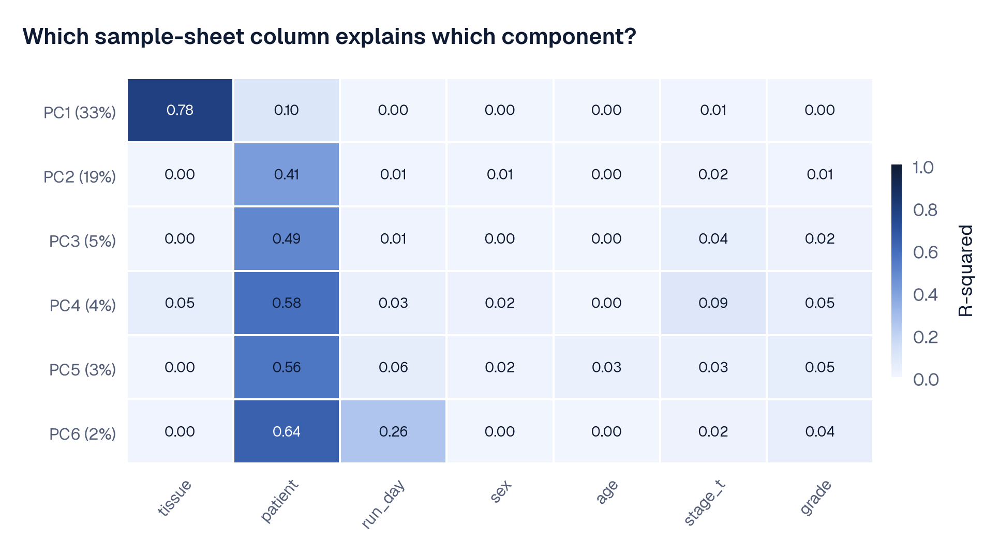 **QC5.** Which sample details explain each component. |
| 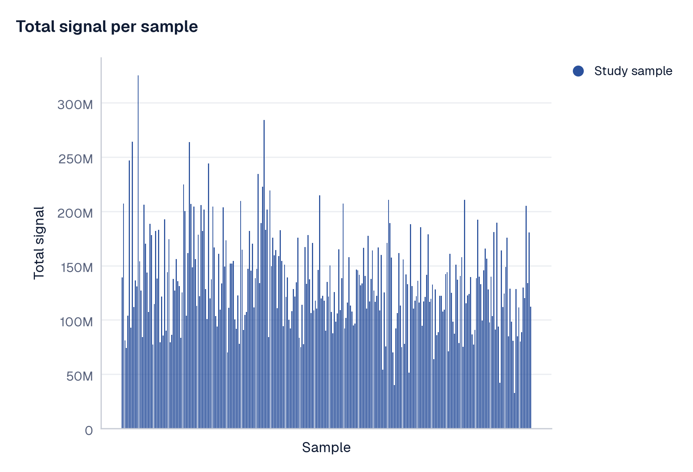 **QC1.** Total lipid signal per sample. | 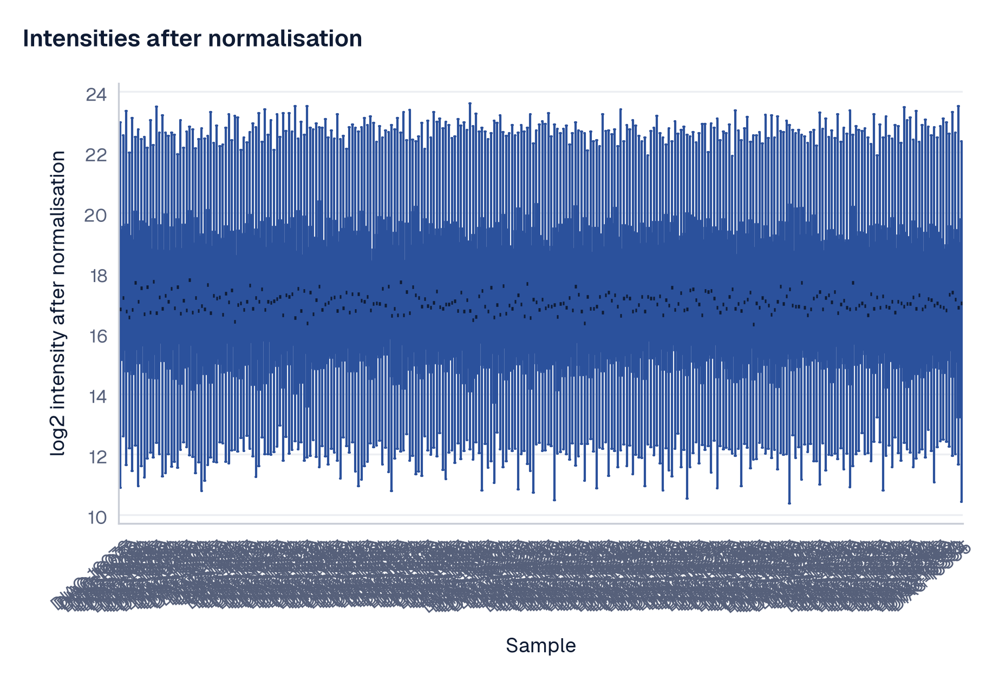 **QC3.** Values after PQN normalisation. |

Filtering (QC2) is in [`figures/`](figures).

---

## Figures

| | |
|---|---|
| 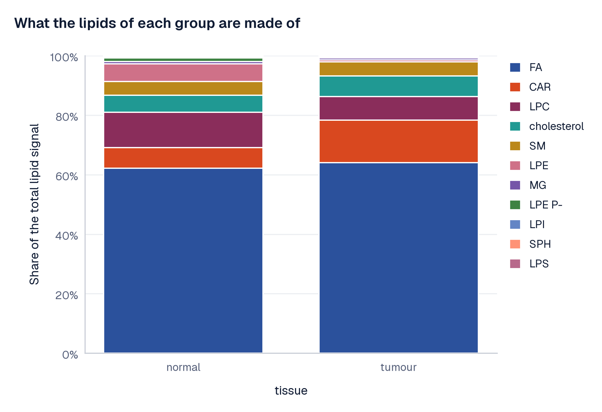 **Figure 1.** What the lipids of each group are made of: acylcarnitines (CAR) grow, lysophospholipids (LPE, LPC) shrink. | 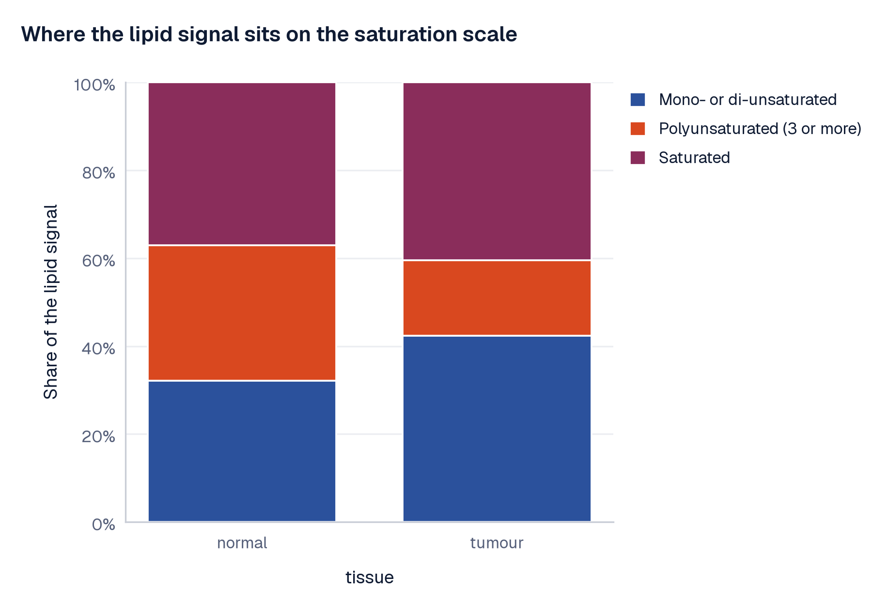 **Figure 3.** The tumour holds fewer polyunsaturated lipids. |
| 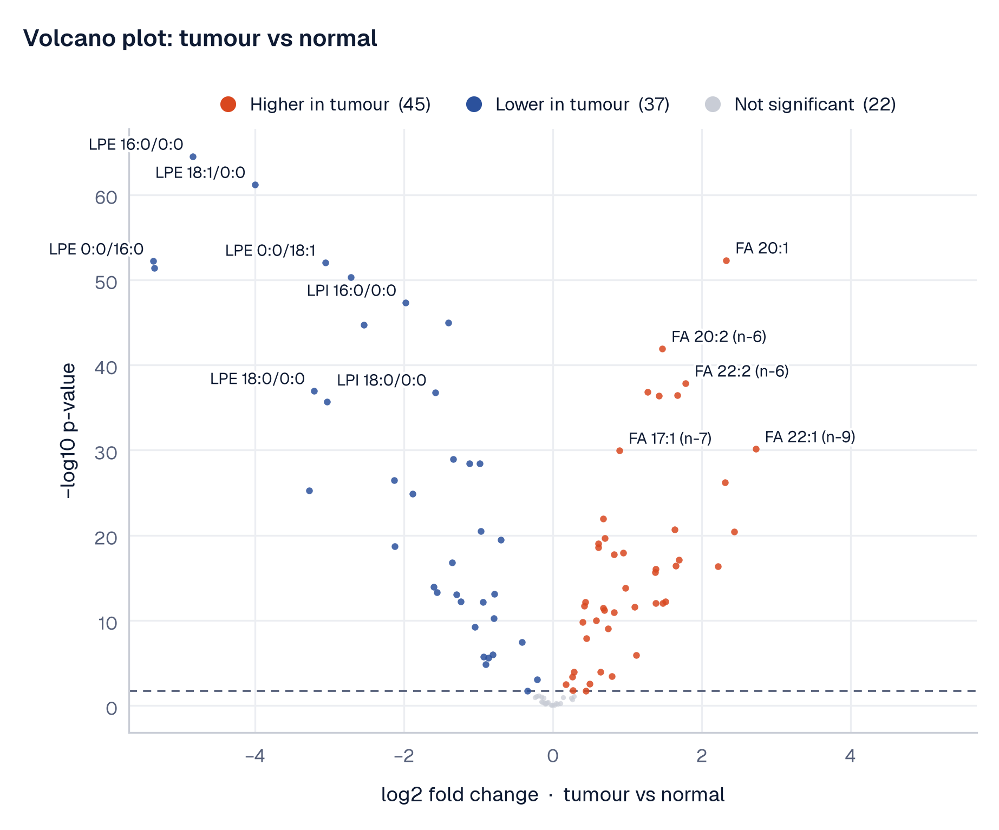 **Figure 6.** Volcano plot: 45 lipids higher and 37 lower in the tumour. | 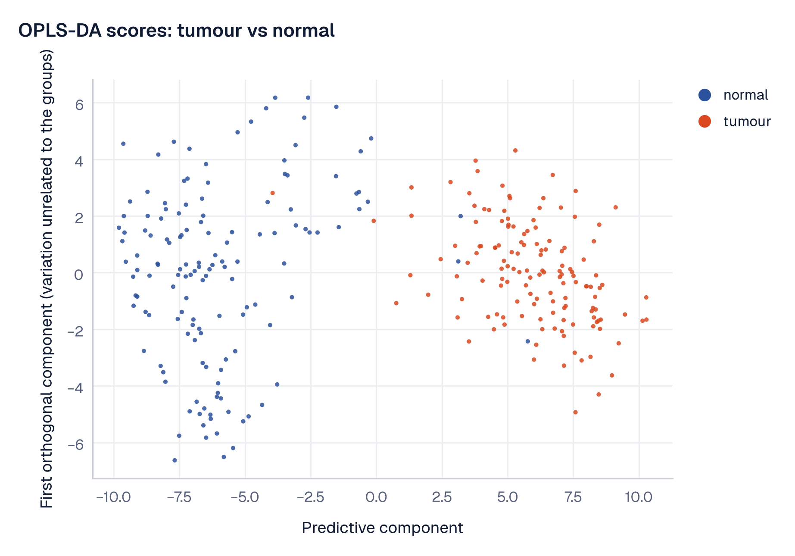 **Figure 8.** OPLS-DA: tumour and normal separate. |

All figures are in [`figures/`](figures), as PNG (300 dpi) and vector PDF:

| File | What it shows |
|---|---|
| 01 | Lipid class composition of each group |
| 02 | Share of each class, tumour vs normal |
| 03 | Saturated, mono- or di-unsaturated and polyunsaturated share |
| 04 | Double bonds per lipid |
| 05 | Saturation within each lipid class |
| 06 | Volcano plot |
| 07 | Top lipids |
| 08 | OPLS-DA scores |
| 09 | Permutation test of the OPLS-DA model |
| qc-pca-* | Quality control and PCA |

## The full report

The lab's own report covers every stage: what was done, why, the checks, the results and their limits. It's available as a [**PDF**](report/LSMA-Analysis-Lab-report-kidney-cancer-lipidomics.pdf) or as [**HTML**](report/LSMA-Analysis-Lab-report-kidney-cancer-lipidomics.html) (download it and open it in a browser for the interactive version).

## Summary tables ([`results/`](results))

| File | Contents |
|---|---|
| `all_lipids_tumour_vs_normal.tsv` | Every tested lipid: fold change, p-value, adjusted p-value and its name in the source data |
| `class_composition.tsv` | Each lipid class as a share of the signal, tumour vs normal, paired test |
| `category_composition.tsv` | The same for broader lipid categories |
| `chain_length_and_saturation.tsv` | Chain length, double bonds and saturation shares, tumour vs normal |
| `chains_by_class.tsv` | Chain length and double bonds within each class |
| `opls_da_vip.tsv` | The importance of each lipid in the OPLS-DA model |
| `sample_qc.tsv`, `lipid_qc.tsv` | Quality metrics per sample and per lipid |

---

## Workflow

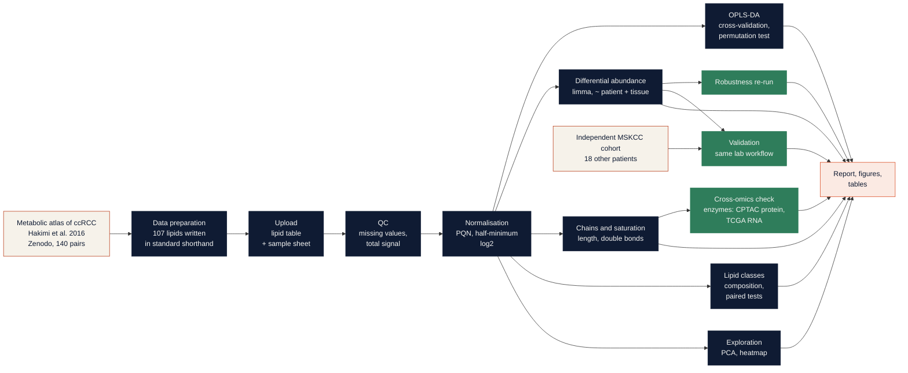

## How it was done

Every lab step below is a stage in the LSMA Analysis Lab, run with the settings in [`settings/analysis-settings.json`](settings/analysis-settings.json).

1. **Data preparation (outside the lab).**
   - **Why it was needed:** no openly licensed lipidomics table of kidney cancer tissue is available. The tissue study of this cohort measured lipids as part of its metabolomics panel, but under chemical names such as "1-palmitoylglycerophosphoethanolamine". The lab's lipidomics module reads structure from standard shorthand, so each lipid was rewritten by a fixed rule; that one becomes `LPE 16:0/0:0`.
   - **Which lipids:** 107 lipids with a defined structure. Other molecules in the lipid group of the source data were left out, because they have no fatty acid chain (for example glycerol, choline, inositols, steroid hormones and bile acids) or because their structure is ambiguous.
   - **What's provided:** the rules are in [`data-preparation/lipid_names_to_shorthand.py`](data-preparation/lipid_names_to_shorthand.py), and every original name with its shorthand is in [`data-preparation/lipid_name_key.tsv`](data-preparation/lipid_name_key.tsv). No values were changed.
2. **Upload and sample preparation.** One lipid table and one sample sheet (tissue, patient, run day, sex, age, stage, grade). The groups were set to tumour vs normal, with normal as the reference, and paired by patient.
3. **QC.** Lipids were kept if measured in at least half of the samples of one group. The lab also checked total signal per sample and flagged outliers.
4. **Normalisation.** Probabilistic quotient normalisation, half-minimum imputation, log2.
5. **Exploration.** PCA on Pareto-scaled data, the association of each component with the sample details, and a heatmap.
6. **Lipid classes.** Each lipid name was parsed into class, carbons and double bonds. Each class was expressed as a share of the sample's lipid signal, and tumour and normal were compared within each patient (paired Wilcoxon test, Benjamini–Hochberg).
7. **Chains and saturation.** Abundance-weighted chain length and double bonds per sample, and the share of saturated, mono- or di-unsaturated and polyunsaturated lipids, compared within each patient.
8. **Differential abundance.** limma with the patient in the model (`~ patient + tissue`); significant at adjusted p < 0.05.
9. **Multivariate model.** OPLS-DA with Pareto scaling, 7-fold cross-validation and 200 permutations.

**Software:** R 4.5.2 and Bioconductor 3.21, with limma and ropls, in the versions listed in the settings file.

## The mathematics behind the methods

The standard forms of the methods used above, as the lab's code applies them. Lipid $i$, sample $j$.

**Half-minimum imputation and probabilistic quotient normalisation (PQN).**

$$
x_{ij} = \tfrac{1}{2} \min_{k} x_{ik} \quad \text{if missing}, \qquad r_i = \operatorname{median}_{j}   x_{ij}, \qquad f_j = \operatorname{median}_{i} \frac{x_{ij}}{r_i}, \qquad y_{ij} = \log_2 \frac{x_{ij}}{f_j}
$$

$x_{ij}$ is the measured intensity. A value below the detection limit is first set to half the smallest measured value of that lipid. The reference profile $r_i$ is the median of each lipid over all samples, and $f_j$ is the most typical ratio of sample $j$ to it, so a more dilute sample has a smaller $f_j$. Dividing by $f_j$ removes the dilution, and the result is log2-transformed.

**Pareto scaling.**

$$
z_{ij} = \frac{y_{ij} - \bar y_i}{\sqrt{s_i}}
$$

$\bar y_i$ and $s_i$ are the mean and standard deviation of lipid $i$. Dividing by the square root of the standard deviation (not by the standard deviation itself) keeps large changes important without letting the noisiest lipids dominate. It is used for the PCA and the OPLS-DA model.

**Class shares.**

$$
c_{Aj} = \frac{\sum_{i \in A} w_{ij}}{\sum_{i} w_{ij}}, \qquad w_{ij} = 2^{y_{ij}}
$$

$y_{ij}$ is the normalised log2 value, so $w_{ij}$ is back on the linear scale, where signals can be added. $c_{Aj}$ is the share of sample $j$'s lipid signal that comes from class $A$ (for example PC or LPE). It is a share of the signal measured, not a concentration.

**Chain length and saturation.**

$$
\bar C_j = \sum_{i} \pi_{ij} C_i, \qquad \bar D_j = \sum_{i} \pi_{ij} D_i, \qquad \pi_{ij} = \frac{w_{ij}}{\sum_{k} w_{kj}}
$$

$C_i$ and $D_i$ are the carbons and double bonds of lipid $i$, summed over its chains as read from the shorthand, and the sums run over the lipids whose chains could be read. $\pi_{ij}$ is each lipid's share of that signal, so an abundant lipid counts for more than a trace one. The shares of saturated (0 double bonds), mono- or di-unsaturated (1 or 2) and polyunsaturated (3 or more) lipids are sums of $\pi_{ij}$ in the same way.

**Paired Wilcoxon signed-rank test, with Benjamini–Hochberg.**

$$
W^{+} = \sum_{h  :  d_h > 0} R_h, \qquad d_h = u_{h,\text{tumour}} - u_{h,\text{normal}}, \qquad p^{\text{adj}}_{(k)} = \min_{l \ge k}   \min\left( 1, \frac{m   p_{(l)}}{l} \right)
$$

For each patient $h$, $d_h$ is the tumour value minus the normal value of a class share or chain measure $u$, and $R_h$ is the rank of $\lvert d_h \rvert$ among all patients. If nothing changes, $W^{+}$ should sit near half the total of the ranks; its p-value makes no assumption about the shape of the data. The reported change is the median of $d_h$. In the BH formula, $p_{(1)} \le \dots \le p_{(m)}$ are the sorted p-values of the $m$ classes (or measures, or lipids) tested.

**Linear model with the paired design (`~ patient + tissue`) and the limma moderated t-statistic.**

$$
y_{ij} = \beta_{i0} + \gamma_{i,p(j)} + \beta_{i1} x_j + \varepsilon_{ij}, \qquad \varepsilon_{ij} \sim \mathcal{N}(0, \sigma_i^2)
$$

$x_j$ is 1 for a tumour and 0 for normal kidney, and $\gamma_{i,p(j)}$ is the effect of the patient $p(j)$. So $\beta_{i1}$ is the log2 fold change of tumour over normal within the same patient. (The code fits one mean per tissue plus the patient terms and takes the contrast tumour − normal, which gives the same estimate.)

$$
\tilde t_i = \frac{\hat\beta_{i1}}{\tilde s_i \sqrt{v_i}}, \qquad \tilde s_i^2 = \frac{d_0 s_0^2 + d_i s_i^2}{d_0 + d_i}
$$

$s_i^2$ is the lipid's residual variance on $d_i$ degrees of freedom, and $v_i$ the unscaled variance of the contrast. Empirical Bayes estimates one prior variance $s_0^2$ on $d_0$ degrees of freedom from all lipids, which steadies the variance of each one. $\tilde t_i$ is compared with a t distribution on $d_0 + d_i$ degrees of freedom, and the p-values are adjusted by Benjamini–Hochberg (above).

**OPLS-DA, cross-validation and the permutation test.**

$$
Z = t_p   p_p^{\mathsf T} + T_o P_o^{\mathsf T} + E, \qquad y = t_p   c + f, \qquad Q^2 = 1 - \frac{\sum_j (y_j - \hat y_{(j)})^2}{\sum_j (y_j - \bar y)^2}
$$

$Z$ is the Pareto-scaled data and $y$ codes each sample's tissue as a number. The predictive component $t_p$ carries the variation in $Z$ that predicts $y$; the orthogonal components $T_o$ carry variation unrelated to the groups. In $Q^2$, $\hat y_{(j)}$ is the prediction for sample $j$ from a model built without it (7-fold cross-validation), so $Q^2$ measures prediction of unseen samples, while $R^2Y$ only measures the fit to the samples the model was built on. The labels were shuffled 200 times and the model refitted each time; the permutation p-value is based on how many shuffled models reach the real model's $Q^2$. VIP ranks each lipid's contribution to the model; values above 1 are above average.

**Spearman correlation (validation).**

$$
\rho = \operatorname{corr}\left( \operatorname{rank}(x), \operatorname{rank}(y) \right)
$$

The correlation of the ranks of the fold changes in the main cohort ($x$) and the independent cohort ($y$). It measures agreement in order, without assuming a straight-line relation.

---

## Validation

### 1. An independent cohort, through the same lab workflow
A second MSKCC tissue study (18 other patients, tumour and normal kidney from each, measured later on a newer platform version) was prepared with the same shorthand rules and analysed with the same settings (30 s). Its lipids were matched to the main cohort by compound ID, then by name or KEGG ID: **71 lipids** were found, and 70 were tested in both cohorts.
- **Some of these patients had received immunotherapy.** For patients with several tumour regions, the first region was used.

| Lipids | Matched | Same direction in the independent cohort | Also significant there |
|---|---|---|---|
| **Strong changes** (adjusted p < 0.05, at least two-fold) | 28 | **28 (100%)** | 25 |
| All significant changes | 58 | 51 (87.9%) | 37 |
| All matched lipids | 70 | 57 (81.4%) | |

The fold changes correlate at **Spearman ρ = 0.86** (Figure V1, left).

**The class and saturation shifts, cohort by cohort** (Figure V1, middle):

| Measure | Main cohort: normal → tumour | Independent cohort: normal → tumour | Replicated? |
|---|---|---|---|
| Polyunsaturated lipids, % of signal | 30.8 → 17.2 | 19.1 → 4.8 (q = 0.0007) | **yes** |
| Double bonds per lipid | 1.71 → 1.27 | 1.13 → 0.50 (q = 0.002) | **yes** |
| LPE, % of signal | 5.9 → 0.6 | 2.5 → 0.1 (q = 0.0001) | **yes** |
| LPC, % of signal | 11.8 → 7.9 | 2.6 → 0.6 (q = 0.0003) | **yes** |
| Acylcarnitines, % of signal | 7.0 → 14.3 | 26.5 → 33.2 (q = 0.29) | same direction, not significant |
| Mono- or di-unsaturated, % of signal | 32.2 → 42.4 | 24.2 → 22.4 (q = 0.17) | **no**: in the independent cohort the lost polyunsaturated signal went to saturated lipids instead |

### 2. Robustness: without the low-signal samples
The three tumours with very low total signal in the [metabolomics run](https://github.com/MultiOmics-Intelligence/lsma-lab-metabolomics-kidney-cancer), and their matched normal samples, were removed and the analysis was run again in the lab (137 pairs, 40 s).
- All 82 significant lipids stay significant (83 in the re-run).
- The fold changes correlate at r = 0.9999.
- The saturation shift is unchanged (−0.44 double bonds per lipid).

### 3. The enzymes explain the lipids
The enzymes behind the main shifts were measured as proteins in the CPTAC cohort and as RNA in TCGA-KIRC: two more sets of patients (Figure V1, right).

| Lipid shift (this analysis) | Enzyme | Protein (CPTAC) | RNA (TCGA) | Reading |
|---|---|---|---|---|
| Fewer polyunsaturated, more mono-unsaturated chains | **SCD**, makes mono-unsaturated fatty acids | **+1.37** | **+3.33** | the tumour desaturates its own fat, as reported by von Roemeling et al. 2013 |
| Fewer polyunsaturated lipids | **ACSL4**, puts polyunsaturated fatty acids into membrane lipids | −0.65 | −1.41 | fewer polyunsaturated chains reach the membrane |
| Lysophospholipids collapse | **PLA2G4A**, cuts phospholipids into lysophospholipids | −0.69 | −1.31 | less made |
| LPE collapses | **PCYT2**, makes the PE that LPE comes from | −1.30 | −1.44 | less of the parent lipid |
| Acylcarnitines build up | **CPT2** and **CRAT**, which use acylcarnitines inside the mitochondria | −1.09 and −1.32 | −0.47 and −0.50 | the mitochondria take up less, so they wait outside, in line with the reduced fatty acid burning reported by Du et al. 2017 |

Every shift points the same way as its enzyme, at protein and RNA level, in patients who are not in this cohort. The lipid droplet coat protein **PLIN2** is also up 5-fold at protein level (+2.41), the storage that gives the cancer its clear look.

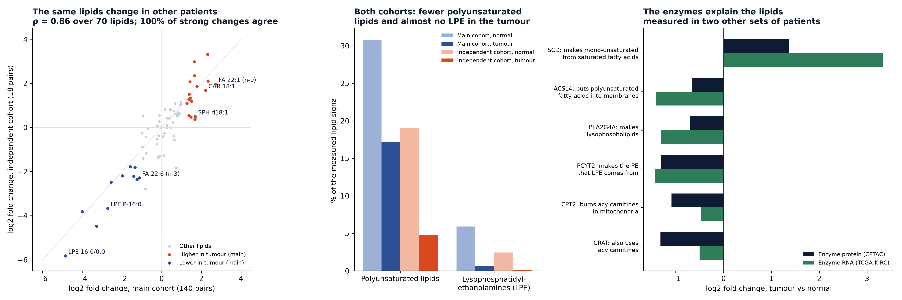

**Figure V1.**
- **Left:** lipid fold changes in the main cohort against the independent cohort.
- **Middle:** polyunsaturated lipids and LPE as a share of the lipid signal, in both cohorts.
- **Right:** the enzymes behind the shifts, at protein and RNA level.

**Verdict: replicated**, except for the rise in mono- or di-unsaturated lipids, which the independent cohort does not show. Tables:
- [`validation/main_vs_independent_cohort.tsv`](validation/main_vs_independent_cohort.tsv)
- [`validation/replication_summary.tsv`](validation/replication_summary.tsv)
- [`validation/class_composition_both_cohorts.tsv`](validation/class_composition_both_cohorts.tsv)
- [`validation/chain_and_saturation_both_cohorts.tsv`](validation/chain_and_saturation_both_cohorts.tsv)
- [`validation/robustness_without_low_signal_samples.tsv`](validation/robustness_without_low_signal_samples.tsv)
- [`validation/lipid_enzymes_protein_and_rna.tsv`](validation/lipid_enzymes_protein_and_rna.tsv)

---

## Limitations

- **Not a dedicated lipidomics method.** The lipids come from a broad metabolomics panel. Membrane lipids with two chains (PC, PE), triacylglycerols and cholesterol esters, the main lipids of the tumour's lipid droplets, were not measured, so the composition describes only the lipids that were.
- **Shorthand written by rule, not measured.** The names were translated from chemical names. Where the source data couldn't tell isomers apart (for example 20:3 n-3 or n-6), the shorthand gives only what is known.
- **The same patients as the metabolomics example.** This analysis and the [metabolomics analysis](https://github.com/MultiOmics-Intelligence/lsma-lab-metabolomics-kidney-cancer) share their samples. The lipid view adds the class, chain and saturation analysis, not new patients.
- **Shares are shares of signal.** A method that sees some classes better than others shapes the composition; changes between groups are more reliable than the absolute shares.
- **No pooled QC samples or blanks in the public data.**
- **The independent cohort is small and partly treated.**
- **A teaching example, not clinical advice.** These results are for education and must not be used to diagnose or treat anyone.

---

## Repository structure

```
lsma-lab-lipidomics-kidney-cancer/
├── README.md                  this case study
├── LICENSE                    CC BY 4.0
├── assets/
│   └── lsma-lab-kidney-lipidome-banner.svg      animated banner
├── data-preparation/          how the lipid names were written in shorthand
│   ├── lipid_names_to_shorthand.py
│   └── lipid_name_key.tsv
├── report/                    the LSMA Analysis Lab's full report
│   ├── LSMA-Analysis-Lab-report-kidney-cancer-lipidomics.pdf
│   └── LSMA-Analysis-Lab-report-kidney-cancer-lipidomics.html
├── figures/                   key figures, PNG (300 dpi) and vector PDF
│   ├── 01-composition ... 09-permutation_test
│   └── qc-pca-*                                quality control and PCA
├── results/                   summary tables (tab-separated)
│   ├── all_lipids_tumour_vs_normal.tsv
│   ├── class_composition.tsv
│   ├── category_composition.tsv
│   ├── chain_length_and_saturation.tsv
│   ├── chains_by_class.tsv
│   ├── opls_da_vip.tsv
│   ├── sample_qc.tsv
│   └── lipid_qc.tsv
├── validation/                independent cohort, robustness, enzymes
│   ├── validation-cohort-saturation-and-enzymes.png / .pdf
│   ├── main_vs_independent_cohort.tsv
│   ├── replication_summary.tsv
│   ├── class_composition_both_cohorts.tsv
│   ├── chain_and_saturation_both_cohorts.tsv
│   ├── robustness_without_low_signal_samples.tsv
│   └── lipid_enzymes_protein_and_rna.tsv
└── settings/
    └── analysis-settings.json          every parameter and software version
```

## Why we share this analysis

This is one of a series of worked examples from the **LSMA Analysis Lab**, published openly for five reasons:

- **To show what the lab does, on real data.** Each repository takes one public dataset through one lab module, from import to report, and shows every step, figure and setting. Nothing is hidden or polished after the fact: the report here is the one the lab produced.
- **To teach a complete analysis, not just a result.** Students see the parts that are usually skipped: quality control, the choice of statistics, an independent validation, and an honest list of limitations.
- **To earn trust by checking known biology first.** These analyses deliberately reproduce findings that are already well established, such as the hypoxia programme and the Warburg switch in kidney cancer. A method that gets the known answers right can be trusted with new questions.
- **To keep testing our own tools.** Every example is a real-world test of the lab. Running public data from start to finish shows what works and what needs fixing, and the fixes go back into the lab for every student. Improvements from this series so far: a more reliable import from NCBI GEO, automatic choice of the right cell-type markers for each tissue in single-cell analysis, and removal of sex-chromosome probes and a more robust DIABLO model in multi-omics.
- **To make the work open and repeatable.** The data are public, every parameter and software version is listed, and diploma students can repeat the same analysis in the lab themselves.

The series follows one cancer, clear cell kidney cancer, through every layer: genes, single cells, DNA methylation, enhancers, mutations, proteins, metabolites and lipids, all of them together in the [multi-omics analysis](https://github.com/MultiOmics-Intelligence/lsma-lab-multi-omics-kidney-cancer-tcga-kirc), and predictions from tumour RNA in the [machine learning analysis](https://github.com/MultiOmics-Intelligence/lsma-lab-machine-learning-kidney-cancer-tcga-kirc). Each repository links to the others.

These examples are for education and must not be used for medical decisions.

## Data source and credits

- **Data:**
  - The original metabolomics tables of the MSKCC kidney cancer cohorts, from the Zenodo archive of Benedetti E, Liu EM, Tang C, et al. (*A multimodal atlas of tumour metabolism reveals the architecture of gene–metabolite co-regulation*, [doi:10.5281/zenodo.7348648](https://doi.org/10.5281/zenodo.7348648), CC BY 4.0).
  - Enzyme comparisons: CPTAC ccRCC proteome ([proteomics repository](https://github.com/MultiOmics-Intelligence/lsma-lab-proteomics-kidney-cancer-cptac)) and TCGA-KIRC RNA ([bulk RNA-seq repository](https://github.com/MultiOmics-Intelligence/lsma-lab-bulk-rnaseq-kidney-cancer-tcga-kirc)).
  - No raw data are copied into this repository.
- **Reference studies:**
  - Hakimi AA, Reznik E, Lee CH, et al. An integrated metabolic atlas of clear cell renal cell carcinoma. *Cancer Cell* 2016;29:104–116.
  - Du W, Zhang L, Brett-Morris A, et al. HIF drives lipid deposition and cancer in ccRCC via repression of fatty acid metabolism. *Nature Communications* 2017;8:1769.
  - von Roemeling CA, Marlow LA, Wei JJ, et al. Stearoyl-CoA desaturase 1 is a novel molecular therapeutic target for clear cell renal cell carcinoma. *Clinical Cancer Research* 2013;19:2368–2380.
- **Methods:**
  - Liebisch et al., *Journal of Lipid Research* 2020 (shorthand notation for lipid structures)
  - Dieterle et al., *Analytical Chemistry* 2006 (probabilistic quotient normalisation)
  - Ritchie et al., *Nucleic Acids Research* 2015 (limma)
  - Thévenot et al., *Journal of Proteome Research* 2015 (ropls, OPLS-DA)
- **Companion analyses** (same cancer):
  - [bulk RNA-seq](https://github.com/MultiOmics-Intelligence/lsma-lab-bulk-rnaseq-kidney-cancer-tcga-kirc)
  - [single-cell RNA-seq](https://github.com/MultiOmics-Intelligence/lsma-lab-single-cell-kidney-cancer-ccrcc)
  - [DNA methylation](https://github.com/MultiOmics-Intelligence/lsma-lab-dna-methylation-kidney-cancer-tcga-kirc)
  - [active enhancers](https://github.com/MultiOmics-Intelligence/lsma-lab-chip-seq-kidney-cancer-enhancers)
  - [somatic mutations](https://github.com/MultiOmics-Intelligence/lsma-lab-somatic-mutations-kidney-cancer-tcga-kirc)
  - [proteomics](https://github.com/MultiOmics-Intelligence/lsma-lab-proteomics-kidney-cancer-cptac)
  - [metabolomics](https://github.com/MultiOmics-Intelligence/lsma-lab-metabolomics-kidney-cancer)
  - [multi-omics](https://github.com/MultiOmics-Intelligence/lsma-lab-multi-omics-kidney-cancer-tcga-kirc)
  - [machine learning](https://github.com/MultiOmics-Intelligence/lsma-lab-machine-learning-kidney-cancer-tcga-kirc)

## Run it yourself

Diploma students of the London School of Multiomics & AI can repeat this analysis in the **LSMA Analysis Lab**:
1. **Datasets** → Upload → *Lipid table*, with the lipid table (names in shorthand, see [`data-preparation/`](data-preparation)) and the sample sheet.
2. In sample preparation, set the groups to tumour vs normal and pair by patient.
3. Run **Lipidomics** with the comparison on `tissue` and the pairing column `patient` for the class and chain stages.

Find out more about the diplomas at [lsma.co.uk](https://lsma.co.uk).

## Licence

The text, figures and tables in this repository are shared under [Creative Commons Attribution 4.0 (CC BY 4.0)](https://creativecommons.org/licenses/by/4.0/): you may reuse them with credit to the London School of Multiomics & AI. The source data remain under their own terms (CC BY 4.0 on Zenodo; CPTAC and TCGA terms for the enzyme data).

---

**Dr. Anas Alzaeem**, Academic Director, London School of Multiomics & AI


